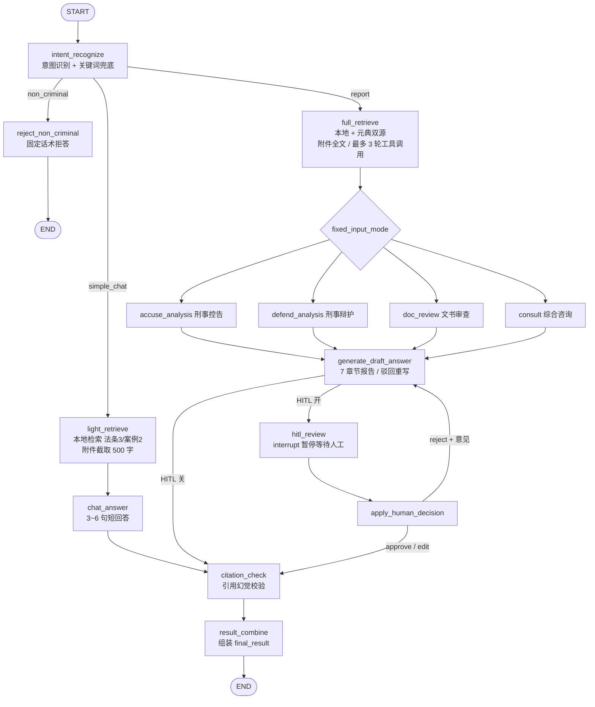

# CriminalCaseAgent · 刑事案件智能分析 Agent

基于 **LangGraph** 编排的刑事法律智能体：意图分流 → 混合检索 RAG（本地知识库 + 元典 MCP 外部法律库）→ 分业务模块分析 → 七章节报告生成 → **HITL 人工复核** → 引用幻觉校验，提供 Streamlit 对话界面与命令行两种使用方式。

- 简单法律问题走轻量链路：少量召回、短回答，低延迟低成本
- 复杂案件走报告链路：双源充分检索、思维链推理、生成结构化法律分析报告，支持人工批准 / 修改 / 驳回重写
- 外部法律检索服务异常时自动熔断降级为纯本地知识库，全链路不中断

> **⚠️ 免责声明：本项目仅供技术学习与研究演示，不构成任何形式的法律意见或法律服务，严禁用于真实案件。详见文末[免责声明](#免责声明)。**

## 功能特性

- **两轴意图识别**：先判「是否刑事相关」，再判「简单问答 / 完整报告」，非刑事问题礼貌拒答；关键词兜底强制报告，防止 LLM 漏判
- **四种刑事业务模式**：刑事控告、刑事辩护、文书审查、综合咨询，每种模式有专属提示词与 7 章报告框架，会话内模式固定
- **混合检索 RAG**：Qdrant 向量召回 + BM25 候选池内打分 + RRF 名次融合 + qwen3-rerank 交叉编码器重排
- **双检索源**：本地 Qdrant 知识库（法条 + 裁判案例）与元典法律平台 MCP 工具（法条 / 案例 / 详情共 7 个刑事工具）
- **三态熔断器**：外部 MCP 连续失败自动打开 → 冷却后半开放探针 → 成功闭合，工具层与提示层双重降级
- **HITL 人工复核**：基于 LangGraph 原生 `interrupt()`，支持批准、人工修改全文、驳回并附意见重写
- **引用幻觉校验**：报告逐条与检索素材核对，输出「全部有依据 / 部分无依据 / 基本无依据」结论
- **附件解析**：支持上传 txt / pdf / docx 案情文书，简单问答截取片段、报告链路给全文
- **可观测与评测**：结构化日志、检索质量评测脚本（Recall / Precision / Context Precision / MRR）、Token 成本对照实验

## 系统架构

### 工作流拓扑（14 个 LangGraph 节点，三条链路）



### 分层结构

```
src/
├── core/          配置（yaml + .env）、路径、日志、提示词分段加载、附件解析
├── llm/           通义千问客户端封装（按 thinking / max_tokens 缓存实例）
├── rag/           入库切分、Qdrant 向量库、向量+BM25+RRF+rerank 混合检索
├── tools/         本地知识库 Function-Calling 工具、元典 MCP 原生客户端 + 熔断
├── graph/         AgentState 状态定义、14 个业务节点、条件边、图编译
├── frontend/      Streamlit 对话界面（会话锁 / 提交队列 / HITL 面板）
└── main.py        命令行入口（含终端 HITL 交互）
```

## 技术栈与模型选型

| 角色 | 选型 | 说明 |
|------|------|------|
| 编排框架 | LangGraph 1.2 / langchain 1.4 | 状态图、`Command(goto)` 动态路由、`interrupt` 人工中断、MemorySaver checkpoint |
| 对话模型 | qwen3.7-plus（DashScope OpenAI 兼容模式） | 仅业务分析与报告生成开启 thinking，其余节点显式关闭以降本提速 |
| 向量模型 | text-embedding-v4（1024 维） | 单条上限 8192 token，批量 embedding 每批 10 条 |
| 重排模型 | qwen3-rerank | 走 DashScope 原生 REST；评测集 14/14 命中、MRR 0.952，优于 gte-rerank-v2 的 12/14、0.857，且单价更低 |
| 向量库 | Qdrant 1.19（本地 Docker） | laws / cases 两个 collection，内容哈希作 point_id，重跑入库幂等 |
| 外部检索 | 元典法律平台 MCP（mcp 2.2.0 streamable HTTP） | 原生 SDK 直连，不引 langchain-mcp-adapters（版本冲突，详见代码注释） |
| 前端 | Streamlit 1.64 | per-thread 锁串行化图调用，防重复提交与 checkpoint 交错写入 |
| 语言 | Python ≥ 3.12 | |

## 快速开始

### 1. 环境准备

```bash
git clone <your-repo-url> CriminalCaseAgent
cd CriminalCaseAgent

python -m venv .venv
# Windows
.venv\Scripts\activate
# Linux / macOS
source .venv/bin/activate

pip install -e .
```

### 2. 启动 Qdrant

```bash
docker compose up -d
```

容器仅把 6333 端口绑定到 `127.0.0.1`（本地无认证，不暴露局域网），数据持久化到 `./data/qdrant`。

### 3. 配置环境变量

```bash
cp .env.example .env
```

编辑 `.env`，至少填写 DashScope API Key（[阿里云百炼控制台](https://bailian.console.aliyun.com/) 获取）：

```ini
DASHSCOPE_API_KEY=sk-xxxxxxxx
DASHSCOPE_BASE_URL=https://dashscope.aliyuncs.com/compatible-mode/v1
LLM_MODEL=qwen3.7-plus
EMBEDDING_MODEL=text-embedding-v4

QDRANT_URL=http://localhost:6333
QDRANT_API_KEY=

# 选填：不配置元典 Token 则外部检索自动关闭，只使用本地知识库
YUANDIAN_MCP_URL=https://open.chineselaw.com/mcp
YUANDIAN_MCP_TOKEN=
```

### 4. 准备语料并入库

仓库不包含语料数据（`data/` 已在 `.gitignore` 中），需自行下载：

| 目录 | 数据集 | 下载地址 | 格式说明 |
|------|--------|----------|----------|
| `data/raws/` | **LexRAG** 法条数据集（`law_library.jsonl`） | https://github.com/CSHaitao/LexRAG | `.jsonl`，每行一条；正文字段按 `text / content / fact / 正文 / 内容 / sentence` 顺序探测，其余字段全部进入 metadata |
| `data/cases/` | **CAIL2018-Small** 刑事裁判数据集（`data_train.json` / `data_valid.json` / `data_test.json`） | https://cail.oss-cn-qingdao.aliyuncs.com/CAIL2018_ALL_DATA.zip | `.json` 数组（加载器兼容 JSONL 内容探测），CAIL 风格数据使用 `fact` 字段、`meta.accusation` 等保留为元数据 |

下载后解压并按上表放置文件（例如 `data/raws/law_library.jsonl`、`data/cases/data_train.json`），随后入库（加载 → 内容哈希精确去重 → 500 字切分 / 50 字重叠 → embedding → upsert）：

```bash
# 小样本试跑（各取前 1000 块，验证维度 / 限流 / 写入）
python -m src.rag.ingestion

# 全量入库
python -c "from src.rag.ingestion import ingest; from src.core.paths import RAWS_DIR, CASES_DIR; ingest(RAWS_DIR, 'laws'); ingest(CASES_DIR / 'data_train.json', 'cases')"
```

同内容重跑会覆盖同一个 Qdrant point，可安全重试。法律文本只做精确哈希去重，不做相似度去重（同款表述在不同法条 / 案件中含义可能完全不同）。

### 5. 运行

**命令行（不启动前端也能跑完整链路，含终端 HITL）：**

```bash
# 简单问答（自动走轻量链路）
python -m src.main "正当防卫的成立条件是什么？"

# 完整辩护分析报告（需要案情时可附附件）
python -m src.main "给我一份完整的刑事辩护分析报告" --mode defend_analysis
python -m src.main "审查这份文书" --mode doc_review --attach ./案情.docx

# 脚本演示用：暂停时自动批准
python -m src.main "出具法律评估：正当防卫如何认定" --auto-approve
```

**Streamlit 界面：**

```bash
streamlit run src/frontend/app.py
```

侧边栏选择业务模块（会话内固定，切换自动新建会话）、开关 HITL、上传附件；报告中断时页面弹出批准 / 修改 / 驳回面板。

## 配置说明

| 文件 | 作用 |
|------|------|
| `configs/config.yaml` | HITL 全局开关、检索 top_k、LLM 模型 / temperature / max_tokens、MCP 熔断阈值 |
| `configs/rag.yaml` | collection 名、embedding 模型与维度、混合检索权重（向量 0.7 / BM25 0.3）、rerank 开关与模型、切分参数 |
| `configs/logging.yaml` | 日志格式与落盘配置 |
| `.env` | 密钥与连接串（密钥只从环境变量读取，不写入 yaml） |

环境变量优先级高于 yaml，便于部署时覆盖；主要变量：

| 变量 | 默认值 | 说明 |
|------|--------|------|
| `DASHSCOPE_API_KEY` | — | **必填** |
| `LLM_MODEL` | `qwen3.7-plus` | 对话模型 |
| `EMBEDDING_MODEL` | `text-embedding-v4` | 向量模型 |
| `QDRANT_URL` | `http://localhost:6333` | Qdrant 地址 |
| `QDRANT_API_KEY` | 空 | 本地 Docker 留空，代码自动转为 `None`（避免发送空头） |
| `YUANDIAN_MCP_TOKEN` | 空 | 元典 Token，留空关闭外部检索 |
| `MCP_FAILURE_THRESHOLD` | `3` | 连续失败几次后熔断打开 |
| `MCP_RECOVERY_TIMEOUT` | `60` | 熔断冷却秒数，过后放行一个探针请求 |

## RAG 检索策略

1. **向量召回**：query 经 text-embedding-v4 向量化，Qdrant 余弦相似度取候选池
2. **BM25 候选池内打分**：不扫全库，只对向量候选做词法打分，兼顾内存与精确匹配（法条编号、数字刑期）
3. **RRF 融合**：只取两路的**名次**不取原始分（余弦与 BM25 分不可直接比较），`k=60` 常数抑制头部噪声，按配置权重 0.7 / 0.3 融合
4. **交叉编码器重排**：融合结果前 15 条送 qwen3-rerank（实测 10~50 条候选对 recall@5 几乎无影响，取 15 把重排成本降到约 30%），再取 top_k
5. **分词**：中文不引入分词依赖，采用单字 + 相邻二元组，英文数字按词切分

重排服务异常时降级返回融合结果；检索层评测与回归：

```bash
python -m scripts.eval_retrieval              # 线上配置（向量 + RRF + rerank）
python -m scripts.eval_retrieval --no-rerank  # 消融：只看召回 + RRF
python -m scripts.eval_retrieval --rerank-model gte-rerank-v2  # 重排模型 A/B
```

输出 Recall@k、Precision@k、Context Precision@k、Hit Rate 与 MRR@k；同一法条被切成多块按条文名去重，Recall 门槛 0.8。

## 元典 MCP 与熔断降级

- 元典平台共 46 个工具，仅把 **7 个刑事相关工具**列入 allowlist 动态包装为 LangChain `StructuredTool`（法条语义 / 关键词检索、案例语义 / 普通 / 权威案例检索、法条详情、案例详情），其余证券合规、企业征信类工具不暴露以免干扰模型选参
- 幻觉校验工具 `yuandian_hall_detect` 不注册为 Agent 工具，只留给校验节点直接调用，避免模型自行触发
- MCP 会话绑定事件循环而工具被同步调用：客户端在守护线程跑独立事件循环，经 `run_coroutine_threadsafe` 桥接，initialize 握手只做一次
- **三态熔断**：闭合 → 连续失败达阈值后打开（快速失败，60s 内不发请求）→ 冷却结束放一个半开探针 → 成功闭合 / 失败重新计时；每次失败同时作废底层连接强制重连
- 检索节点对元典异常不抛出循环外，而是把错误作为 ToolMessage 回喂模型，提示其仅使用本地结果继续

## HITL 人工复核

报告生成后经 LangGraph `interrupt(payload)` 暂停，payload 携带初稿、章节标题与三个动作；前端通过 `Command(resume=decision)` 恢复，`apply_human_decision_node` 互斥路由：

| 动作 | 行为 |
|------|------|
| `approve` | 初稿不动，进入引用校验 |
| `edit` | 人工修改后的全文写回 `draft_legal_output`，进入引用校验；提交空白文本则告警并降级为批准 |
| `reject` | 带回上一版报告与驳回意见跳回报告生成节点重写，重写完成自动清空决策并重新进入复核 |

前端 resume 数据经 `_normalize_decision` 校验，结构缺失或非法动作一律兜底为批准，保证异常输入不会卡死图。

## 成本评测

```bash
python -m scripts.eval_cost.run            # 全部实验
python -m scripts.eval_cost.run --only e2  # 单组
```

- **E1（实测）两级链路分流**：同一标注样本分别走 simple_chat 与强制 report，对照单条 query 的 token 节省比例
- **E2（实测）thinking 精准配置**：意图识别 / 引用校验等节点关闭思考 vs 全节点开启的 token 对比
- `TokenUsageHandler` 以旁路 Callback 按 LangGraph 节点分桶统计，同时读取 `usage_metadata` 与 OpenAI 原生 `token_usage` 兼容 SDK 差异；实验全程 patch 掉元典工具，只产生 DashScope 费用

## 工程设计要点

- **提示词即配置**：`prompts/*.md` 按 `## 段名` 分段（system / user），按文件 mtime 缓存，改提示词无需重启
- **降级无处不在**：意图识别失败 → 刑事 + 简单问答；业务分析 / 报告 / 校验模型失败 → 透传素材 / 骨架报告 / 人工核对提示，任何单节点故障都不阻断主链路
- **节点名常量化**：图注册名与 `Command(goto=)` 引用同一份常量，避免字符串不一致
- **幂等入库**：内容哈希作 point_id，精确去重 + 可重复执行
- **前端并发安全**：提交只入队、抢锁即认领（先清队列再执行），覆盖 WebSocket 重连 / 重复点击场景；checkpoint 为权威状态定期校准 UI
- **密钥安全**：API Key 只从环境变量读取；MCP 异常文本经脱敏后才入日志 / 对外抛出

## 项目结构

```
CriminalCaseAgent/
├── configs/                 # 全局 / RAG / 日志配置
├── prompts/                 # 10 个节点提示词模板
├── data/                    # 语料与 Qdrant 持久化（gitignore，需自备）
│   ├── raws/                #   法条 JSONL
│   ├── cases/               #   裁判文书 JSON
│   └── qdrant/              #   Qdrant 存储卷
├── scripts/
│   ├── eval_retrieval.py    # 检索质量评测
│   └── eval_cost/           # Token 成本对照实验（E1 / E2）
├── src/
│   ├── core/  ├── llm/  ├── rag/
│   ├── tools/ ├── graph/ ├── frontend/
│   └── main.py              # CLI 入口
├── docker-compose.yml       # Qdrant（127.0.0.1:6333）
├── pyproject.toml
└── .env.example
```

## 免责声明

1. **学习演示用途**：本项目是人工智能与检索增强生成（RAG）技术的个人学习与工程演示项目，并非律师事务所、法律服务机构或执业律师提供的产品，**不得用于任何真实案件、诉讼活动、司法实务或商业法律服务**。

2. **不构成法律意见**：系统输出（包括但不限于法律分析、罪名解读、量刑预测、报告初稿、引用校验结论及类案检索结果）由大语言模型基于有限语料自动生成，可能存在**法条过期、引用错误、案例失实、逻辑疏漏、幻觉编造**等问题，不保证准确性、完整性、时效性与可靠性，不构成法律意见、辩护策略或任何决策依据。

3. **数据非权威来源**：内置知识库由第三方公开数据集（法条：[LexRAG](https://github.com/CSHaitao/LexRAG)；案例：[CAIL2018](https://cail.oss-cn-qingdao.aliyuncs.com/CAIL2018_ALL_DATA.zip)）构建，数据版权归原作者所有，内容可能滞后或有误，不代表现行有效法律法规及司法解释；外部检索结果（如元典平台）的版权与准确性归相应数据方所有。法律法规的适用以全国人大、最高人民法院、最高人民检察院等官方机关发布的现行有效文本为准。

4. **使用者风险自负**：任何单位或个人因参考、引用、依赖本项目输出而作出或不作任何行为所导致的一切后果与损失，**由使用者自行承担，项目作者及贡献者不承担任何法律责任**。

5. **涉刑事案件请寻求专业帮助**：刑事案件直接关系人身自由与生命权，具有高度专业性和个案差异性。如遇真实法律问题，请及时委托执业律师或向当地法律援助机构、司法行政机关寻求专业帮助。

6. **使用即视为同意**：下载、复制、部署、运行或以其他方式使用本项目，即表示您已阅读、理解并同意本声明的全部内容。

## License

本项目采用 [MIT License](LICENSE) 开源协议。

第三方数据集（LexRAG、CAIL2018）版权归原作者所有，不随本仓库分发；使用时请遵守其各自的许可条款。本项目的免责声明不因 MIT 协议而失效，输出内容严禁用于真实案件。
